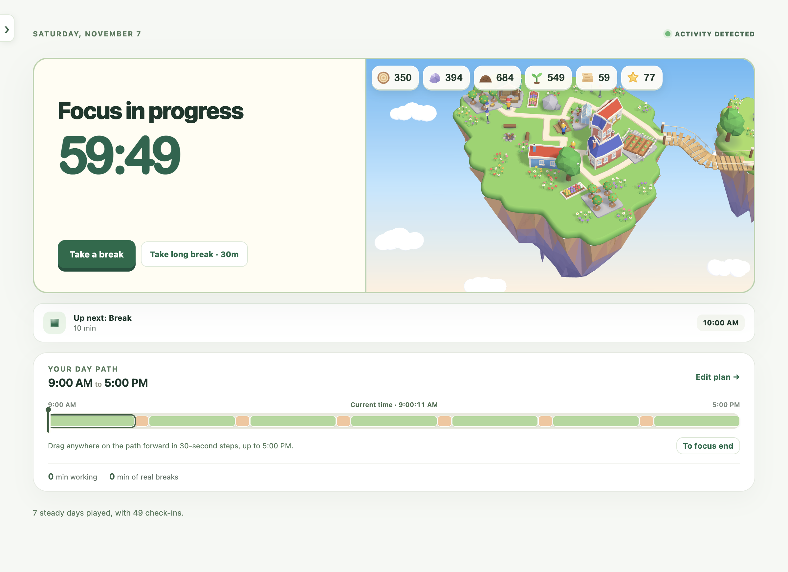

# Focus Islands



A local macOS menu bar app that helps you focus, take real breaks, and grow a little sky island along the way.

- Plan your day around meetings, with flexible focus and break blocks.
- Detect time away automatically and get visual break reminders across your monitors.
- Compare your plan with what actually happened. Forgot to start? Record an earlier start time.
- Grow islands and collect helpers through regular work and real breaks.

Everything stays on your Mac. No keystrokes or browsing history are collected.

## Run

Requires macOS and Node.js 22.13+.

```sh
npm install
scripts/run-personal.sh
```

This builds and installs `/Applications/Focus Islands.app`. Open it from Spotlight afterward; rerun the script after quitting to install code updates. Use the menu bar island to open or quit the app.

To try the game without waiting through real sessions: `scripts/run-game-demo.sh`.

For development, see [AGENTS.md](AGENTS.md). State ownership is documented in [STATE_PLAN.md](STATE_PLAN.md).
